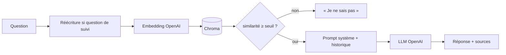

# Hotel RAG Assistant

Assistant conversationnel pour un hôtel fictif (Le Belvédère, lac d'Annecy) : il répond aux questions des clients **uniquement à partir de la documentation de l'hôtel** (PDF), cite ses sources et dit « Je ne sais pas » quand l'information n'y est pas.

<!-- TODO : capture d'écran de l'interface (docs/demo.png) -->


## Fonctionnalités

- **RAG sur PDF** : une page de PDF = une rubrique, indexée dans Chroma (persistant sur disque).
- **Conversation avec mémoire** : l'historique est transmis au LLM, et les questions de suivi (« Et jusqu'à quelle heure ? ») sont réécrites en questions autonomes avant la recherche.
- **Sources affichées** sous chaque réponse.
- **Garde-fous contre les hallucinations** : consigne stricte dans le prompt + seuil de similarité calibré (le LLM n'est pas appelé si rien de pertinent n'est trouvé).
- **Évaluation reproductible** : recall@k, MRR et marge de similarité sur un jeu de questions versionné.

## Architecture



| Composant | Choix |
|---|---|
| Embeddings | `text-embedding-3-small` (1536 dimensions) |
| Génération | `gpt-4o-mini`, `temperature=0` |
| Base vectorielle | Chroma (cosinus, persistante) |
| Interface | Gradio |

## Installation

Prérequis : Python 3.10+ et une clé API OpenAI.

```bash
git clone https://github.com/<ton-compte>/hotel-rag-assistant.git
cd hotel-rag-assistant
python -m venv .venv && source .venv/bin/activate     # Windows : .venv\Scripts\activate
pip install -e ".[dev]"

cp .env.example .env                                  # puis renseigne OPENAI_API_KEY
python scripts/ingest.py                              # construit l'index Chroma
python app.py                                         # http://127.0.0.1:7860
```

Les PDF se placent dans `data/`. Relance `ingest.py` après chaque modification.

## Évaluation

Le jeu de test (`eval/eval_set.json`) contient **TODO** questions : directes, indirectes (« Je risque d'arriver à minuit »), ambiguës, et formulées dans un autre registre ou une autre langue.

```bash
python scripts/evaluate.py
```

| Métrique | Valeur |
|---|---|
| recall@1 | TODO |
| recall@2 | TODO |
| recall@5 | TODO |
| MRR | TODO |
| marge moyenne | TODO |

- **recall@k** : part des questions dont la bonne rubrique est dans les `k` premiers résultats.
- **MRR** : moyenne de 1/rang de la bonne rubrique.
- **marge** : similarité de la bonne rubrique moins celle de la meilleure autre rubrique. Elle reste informative quand le recall est déjà à 100 %.

Sur 15 rubriques distinctes, le recall sature vite : la marge et les questions ambiguës sont ce qui distingue vraiment deux configurations.

## Seuil de similarité

Si la similarité du meilleur résultat est sous `SIMILARITY_THRESHOLD`, l'assistant répond « Je ne sais pas » **sans appeler le LLM** (moins de coût, moins de latence, pas d'hallucination possible sur ce cas).

Le seuil est mesuré, pas deviné :

```bash
python scripts/calibrate_threshold.py     # compare questions valides et hors périmètre (eval/out_of_scope.json)
```

Valeur retenue : **TODO** (garde 100 % des questions valides, bloque TODO % des questions hors périmètre).

Limite connue : une question proche du sujet mais absente de la documentation (ex. « Acceptez-vous le Bitcoin ? » face à la rubrique paiements) dépasse le seuil. C'est alors la consigne du prompt qui provoque le refus.

## Expériences

<!-- TODO : à compléter avec tes résultats, ou supprimer la section -->

**Chunking avec chevauchement** (tailles 20 / 40 / 80 mots) : TODO (effet sur la marge moyenne, décision retenue et pourquoi).

**Recherche vectorielle à l'échelle** (corpus synthétique, vecteurs de dimension 1536) :

| Vecteurs | numpy (ms) | FAISS Flat (ms) | FAISS HNSW (ms) | HNSW recall@10 |
|---|---|---|---|---|
| 10 000 | TODO | TODO | TODO | TODO |
| 50 000 | TODO | TODO | TODO | TODO |
| 100 000 | TODO | TODO | TODO | TODO |

À 15 vecteurs, la différence est invisible : numpy suffirait. Chroma est retenu pour la persistance, les métadonnées et les filtres, pas pour la vitesse.

## Choix et limites

- Pas de reranking : avec 15 rubriques, le gain serait marginal.
- L'historique vit dans la session Gradio (pas de persistance entre deux visites).
- La réécriture des questions de suivi ajoute un appel LLM par tour.
- Le jeu d'évaluation est petit : les métriques indiquent une tendance, pas une garantie.
- Le seuil dépend du modèle d'embedding : à recalibrer si on le change.

## Structure

```
src/hotel_rag/     config, llm (OpenAI), ingestion (PDF), store (Chroma), generation, pipeline
scripts/           ingest.py, evaluate.py, calibrate_threshold.py
eval/              eval_set.json, out_of_scope.json
tests/             tests unitaires (sans appel API)
app.py             interface Gradio
```

```bash
pytest
```

## Données et crédits

<!-- TODO : documents fictifs écrits par moi / source de l'atelier d'origine et licence -->

## Licence

MIT (code). Données : TODO.