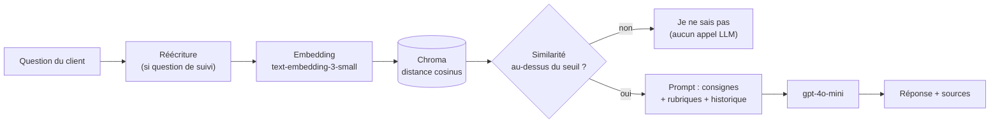
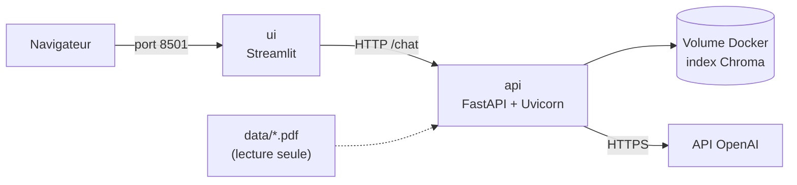

# Hôtel Le Belvédère : assistant conversationnel RAG


Assistant qui répond aux questions des clients d'un hôtel fictif (Le Belvédère, au bord du lac d'Annecy) **uniquement à partir de sa documentation** (5 PDF). Il cite ses sources, comprend les questions de suivi et répond « Je ne sais pas » quand l'information ne figure pas dans les documents.


## Contexte

Un hôtel reçoit chaque jour les mêmes questions : horaires de la réception, tarifs des chambres, accès au spa, animaux acceptés, activités. Les réponses existent, mais dispersées dans plusieurs documents. Confier ces questions à un LLM seul poserait un vrai problème : il répond avec aplomb, y compris quand il invente un prix ou un horaire.

Le projet applique la **génération augmentée par la recherche (RAG)** : le modèle ne répond qu'avec les passages de la documentation retrouvés pour la question posée, et refuse quand rien de pertinent n'existe.

Objectifs :

- des réponses **fondées sur les documents**, avec leurs sources
- un **refus explicite** hors périmètre, plutôt qu'une réponse inventée
- une **conversation** (la question « Et jusqu'à quelle heure ? » doit être comprise)
- un projet **mesuré et reproductible** : évaluation chiffrée, tests, déploiement par conteneurs

## Aperçu

| Réponse avec sources | Refus hors périmètre |
|---|---|
|  |  |

| Documentation de l'API (`/docs`) | Conteneurs en fonctionnement |
|---|---|
|  |  |

## Fonctionnalités

- **RAG sur PDF** : chaque page est une rubrique, indexée dans Chroma (stockage persistant sur disque).
- **Sources affichées** sous chaque réponse (document et rubrique).
- **Mémoire de conversation** : les questions de suivi sont réécrites en questions autonomes avant la recherche.
- **Seuil de similarité calibré** : si rien de pertinent n'est trouvé, l'assistant refuse sans appeler le LLM.
- **Consigne stricte** dans le prompt : réponse courte, source unique autorisée, phrase de refus exacte.
- **API REST** (FastAPI) sans état, avec validation des entrées et codes d'erreur explicites.
- **Interface de chat** (Streamlit) : plusieurs conversations, questions suggérées, relance après une erreur.
- **Évaluation reproductible** : recall@k, MRR et marge de similarité, plus des questions hors périmètre.
- **Déploiement Docker Compose** : un conteneur API, un conteneur interface, un volume pour l'index.

## Architecture

### Chemin d'une question



### Déploiement



L'interface ne contient aucune logique de recherche : elle appelle l'API, qui appelle le pipeline. Chaque couche se remplace sans toucher aux autres.

## Stack technique

| Outil | Rôle |
|---|---|
| **Python 3.12+**, **uv** | langage, gestion des dépendances et fichier de verrouillage |
| **pypdf** | extraction du texte des PDF |
| **OpenAI** `text-embedding-3-small` | embeddings (vecteurs de dimension 1536) |
| **OpenAI** `gpt-4o-mini` | génération des réponses et réécriture des questions de suivi (`temperature=0`) |
| **ChromaDB** | base vectorielle persistante, distance cosinus |
| **FastAPI**, **Pydantic**, **Uvicorn** | API HTTP, validation des requêtes, serveur |
| **Streamlit**, **httpx** | interface de chat, client de l'API |
| **Docker**, **Docker Compose** | conteneurs `api` et `ui`, volume pour l'index |
| **pytest** | tests unitaires sans réseau, `TestClient` de FastAPI |
| **python-dotenv** | configuration par variables d'environnement |

## Démarrage rapide

Prérequis : Python 3.12+, [uv](https://docs.astral.sh/uv/) et une clé API OpenAI.

```bash
git clone https://github.com/<ton-compte>/<ton-depot>.git
cd <ton-depot>

uv venv && source .venv/bin/activate          # Windows : .venv\Scripts\activate
uv pip install -e ".[ui,dev]"

cp .env.example .env                          # puis renseigne OPENAI_API_KEY dans .env
python scripts/ingest.py                      # extrait les PDF et construit l'index Chroma
```

**En local** (deux terminaux) :

```bash
uvicorn hotel_rag.api:app --reload --reload-dir src --port 8001
API_URL=http://localhost:8001 streamlit run streamlit_app.py      # http://localhost:8501
```

**Avec Docker Compose** :

```bash
docker compose up -d --build
docker compose run --rm api python scripts/ingest.py             # construit l'index dans le volume
docker compose restart api                                        # l'API relit l'index
```

- Interface : <http://localhost:8501>
- API et documentation interactive : <http://localhost:8002/docs>

Les ports publiés se modifient dans `docker-compose.yml`. Ne publie pas l'API sur Internet sans authentification : chaque requête consomme des appels OpenAI.

### Configuration

| Variable | Rôle | Défaut |
|---|---|---|
| `OPENAI_API_KEY` | clé OpenAI (**obligatoire**) | aucun |
| `SIMILARITY_THRESHOLD` | similarité minimale du meilleur résultat, `0.0` désactive le seuil | `0.0` |
| `LLM_MODEL` | modèle de génération | `gpt-4o-mini` |
| `EMBEDDING_MODEL` | modèle d'embeddings (changer impose de relancer `ingest.py`) | `text-embedding-3-small` |
| `DATA_DIR`, `CHROMA_DIR` | dossier des PDF, dossier de l'index | `data/`, `.chroma/` |
| `API_URL` | adresse de l'API, lue par l'interface | `http://localhost:8001` |
| `API_KEY` | clé d'accès à l'API (`X-API-Key`), facultative | aucune |
| `SHOW_SCORES` | `0` masque les scores de similarité dans l'interface | `1` |

### API

| Route | Rôle |
|---|---|
| `POST /chat` | `{"question": "...", "history": [{"role": "user", "content": "..."}]}` renvoie la réponse, la question réécrite et les sources |
| `GET /health` | le processus répond (et taille de l'index) |
| `GET /ready` | prêt à répondre : `503` tant que l'index est vide |

Codes d'erreur : `422` requête invalide, `401` clé absente ou fausse, `503` index absent, `502` erreur du fournisseur LLM, `504` délai dépassé.

## Méthodologie

Le projet suit une règle : **on construit de la donnée vers l'interface, et chaque couche est validée avant de passer à la suivante**.

| Principe | Application |
|---|---|
| Les données d'abord | le texte extrait des PDF est relu avant toute indexation |
| Évaluer la recherche séparément de la génération | pour comprendre une mauvaise réponse, on regarde d'abord les rubriques récupérées |
| Un seul modèle d'embedding | même modèle pour l'index et les questions ; en changer impose de ré-indexer et de recalibrer le seuil |
| Le prompt est un contrat | rôle, source unique autorisée, format, phrase de refus exacte |
| Deux filets contre l'invention | le seuil (avant le LLM) et la consigne (dans le LLM) |
| Mesurer avant d'optimiser | `top_k`, seuil et prompt se choisissent sur le jeu d'évaluation |
| Configuration et secrets hors du code | `.env` non versionné, `.env.example` versionné |
| Chaque couche testable sans réseau | les appels OpenAI sont remplacés par des doublures dans les tests |

## Étapes de réalisation

| # | Étape | Ce qui a été fait | Critère de validation |
|---|---|---|---|
| 1 | Cadrer | documentation de l'hôtel (5 PDF), questions types, comportement attendu | un jeu de questions avec la rubrique attendue |
| 2 | Comprendre les documents | extraction avec `pypdf` : une page = une rubrique (titre et texte) | 15 rubriques, titres corrects |
| 3 | Baseline sans RAG | toute la documentation dans le prompt, avec les modèles locaux du notebook d'origine (Qwen2.5-0.5B-Instruct, MiniLM multilingue) | référence pour mesurer l'apport du RAG |
| 4 | Indexer et rechercher | passage à l'API OpenAI, embeddings, index Chroma en cosinus, `top_k` | la bonne rubrique en tête sur les questions simples |
| 5 | Évaluer la recherche | `eval/eval_set.json`, recall@k, MRR, marge de similarité, questions difficiles | baseline chiffrée (voir Résultats) |
| 6 | Générer avec ancrage | prompt système (rôle, documentation, consigne, phrase de refus), `temperature=0` | réponses fondées, refus hors périmètre |
| 7 | Fiabiliser | seuil calibré (`eval/out_of_scope.json`), réécriture des questions de suivi, mémoire limitée | tableau de calibration, suivi compris |
| 8 | Industrialiser | package `src/hotel_rag`, configuration `.env`, tests, API FastAPI, interface Streamlit, Docker Compose | `pytest` vert, `/health` OK, conteneurs sains |
| 9 | Documenter | ce README, résultats chiffrés, limites | aucune clé dans l'historique git |

## Résultats

> **TODO avant publication** : remplace chaque `TODO` par ta mesure (commande indiquée), puis supprime cette ligne. Sont déjà connus : le nombre de documents et de rubriques, le jalon initial de la recherche et l'exemple de réponse.

### Corpus

| Élément | Valeur |
|---|---|
| Documents | 5 PDF |
| Rubriques indexées | 15 |
| Longueur des rubriques (mots, min / médiane / max) | TODO |

### Qualité de la recherche

Jeu d'évaluation : **TODO** questions (directes, indirectes, ambiguës, autre registre ou autre langue). Commande : `python scripts/evaluate.py`.

| Métrique | Valeur |
|---|---|
| recall@1 | TODO |
| recall@2 | TODO |
| recall@5 | TODO |
| MRR | TODO |
| marge de similarité moyenne | TODO |

- **recall@k** : part des questions dont la bonne rubrique figure dans les `k` premiers résultats.
- **MRR** : moyenne de l'inverse du rang de la bonne rubrique.
- **marge** : similarité de la bonne rubrique moins celle de la meilleure autre rubrique. Elle reste informative quand le recall atteint déjà 100 %.

Jalon initial : sur 6 questions, recall à 100 % pour tous les `k`, MRR de 1,0 et marge moyenne de 0,105. Ce jeu était trop facile pour départager deux configurations, d'où l'ajout de questions difficiles.

### Seuil de similarité

Commande : `python scripts/calibrate_threshold.py`.

| Élément | Valeur |
|---|---|
| Seuil retenu | TODO |
| Questions valides conservées | TODO |
| Questions hors périmètre bloquées par le seuil | TODO |

Le seuil retient 100 % des questions valides : un refus à tort coûte plus cher qu'une question hors périmètre qui passe, puisque la consigne du prompt la refuse ensuite.

### Qualité de la génération

| Mesure | Valeur |
|---|---|
| Questions valides refusées à tort | TODO / TODO |
| Questions hors périmètre qui reçoivent une réponse inventée | TODO / TODO |

### Coût et latence

Nombre d'appels à l'API OpenAI par tour (déterminé par le code) :

| Situation | Embedding | Réécriture | Réponse | Total |
|---|---|---|---|---|
| première question | 1 | 0 | 1 | 2 |
| question de suivi | 1 | 1 | 1 | 3 |
| refus par le seuil, première question | 1 | 0 | 0 | 1 |
| refus par le seuil, question de suivi | 1 | 1 | 0 | 2 |

Latence médiane d'une réponse : **TODO** secondes (mesure : `curl -s -o /dev/null -w '%{time_total}\n' -X POST localhost:8002/chat -H 'Content-Type: application/json' -d '{"question": "A quelle heure ouvre la réception ?"}'`).

### Exemple

> **Client :** Combien coûte une chambre Classique en basse saison ?
>
> **Assistant :** Une chambre Classique coûte à partir de 120 euros la nuit en basse saison.
>
> *Sources : Chambres et tarifs, Politique d'annulation et de paiement*

### Suite de tests

`pytest` : **TODO** tests, sans appel réseau.

## Tests

```bash
pytest                          # tests unitaires : prompt, seuil, pipeline, API
python scripts/evaluate.py      # qualité de la recherche
```

Un notebook de test de bout en bout (`notebook/smoke_test.ipynb`) vérifie l'ensemble de la chaîne avant publication : ingestion, OpenAI, index, recherche, pipeline, API, hygiène du dépôt.

## Structure du dépôt

```
.
├── src/hotel_rag/
│   ├── config.py        # réglages (modèles, chemins, seuil), chargés depuis l'environnement
│   ├── llm.py           # seul point de contact avec OpenAI : embed() et chat()
│   ├── ingestion.py     # PDF -> rubriques (Section)
│   ├── store.py         # index Chroma : build_index(), search()
│   ├── generation.py    # prompts, phrase de refus, réécriture des questions de suivi
│   ├── pipeline.py      # un tour de conversation : réécriture, recherche, seuil, réponse
│   └── api.py           # API FastAPI
├── streamlit_app.py     # interface de chat
├── scripts/             # ingest.py, evaluate.py, calibrate_threshold.py
├── eval/                # eval_set.json, out_of_scope.json
├── tests/
├── data/                # PDF de l'hôtel
├── docs/screenshots/    # captures d'écran du README
├── Dockerfile
├── docker-compose.yml
└── pyproject.toml
```

Chaque module ne dépend que de ceux qui le précèdent : `config`, `llm`, `ingestion`, `store`, `generation`, `pipeline`, `api`.

## Choix techniques et compromis

| Décision | Raison | Contrepartie |
|---|---|---|
| API OpenAI plutôt que des modèles locaux | pas de GPU nécessaire, qualité de génération supérieure à un modèle de 0,5 milliard de paramètres | dépendance au réseau, coût par requête, textes envoyés à un fournisseur |
| Chroma plutôt que numpy ou FAISS | persistance, métadonnées et filtres ; à 15 vecteurs la vitesse ne compte pas | mode local limité à un seul processus |
| API sans état, historique envoyé par le client | on peut redémarrer ou dupliquer le serveur sans rien perdre | un client peut forger des messages `assistant` |
| Seuil avant l'appel au LLM | économise un appel, limite les réponses inventées | une question proche du sujet mais absente de la documentation passe le seuil |
| Réécriture des questions de suivi | la recherche vectorielle ne voit pas l'historique | un appel de plus par tour |
| Pas de découpage en passages | une page = une rubrique courte | à revoir pour des documents longs |
| Interface séparée de l'API | chaque couche se remplace ou se met à l'échelle seule | deux conteneurs au lieu d'un |

## Limites et écart avec la production

Ce projet est une démonstration, pas un service prêt pour la production :

- **Corpus fictif de 15 rubriques** : les résultats ne se généralisent pas à des PDF réels (colonnes, tableaux, scans, en-têtes répétés).
- **Jeu d'évaluation de petite taille** : les métriques donnent une tendance, pas une garantie.
- **Authentification minimale** : une clé d'API optionnelle, pas de SSO, pas de limitation de débit.
- **Historique côté client** et **conversations perdues au rechargement de la page** (état de session Streamlit).
- **Index local**, un seul processus : plusieurs réplicas demanderaient une base vectorielle en mode serveur.
- **Pas de suivi des requêtes** (traces, coût, retours utilisateurs) ni d'alertes.
- **Documents mis à jour à la main** : pas d'ingestion incrémentale.

## Pistes d'amélioration

- Recherche hybride (mots-clés et vecteurs) et reranking.
- Découpage par structure puis par taille pour des documents longs.
- Évaluation de la **fidélité** des réponses (la réponse contient-elle des faits absents des sources ?).
- Suivi des requêtes avec Langfuse ou OpenTelemetry.
- CI GitHub Actions : `pytest` et `evaluate.py` à chaque modification, avec seuil d'échec sur le recall.
- Ingestion incrémentale et base pgvector ou Qdrant.
- Réponses en streaming.

## Données et crédits

> **TODO** : précise l'origine des documents (rédigés par toi ou fournis par l'atelier d'origine), la source du notebook de départ et la licence applicable. Si les PDF ne peuvent pas être publiés, retire `data/` du dépôt et décris le format attendu.

## Licence

TODO (par exemple MIT pour le code).

## Auteur

**Ibrahim Soilahoudine**, Data Scientist freelance : [LinkedIn](https://linkedin.com/in/soilah-5a166225b) · [Malt](https://www.malt.fr/profile/ibrahimsoilahoudine)
